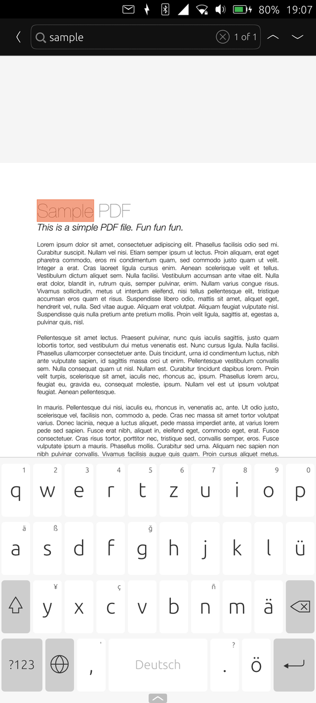

# ubDocView


A fork of the [Lomiri Document Viewer](https://gitlab.com/ubports/development/apps/lomiri-docviewer-app)
for Ubuntu Touch that adds **full-text search in PDF documents**. Everything
else — PDFs, LibreOffice formats (ODT, DOCX, XLSX, PPTX, …), plain text — works
as in the original app.

## Screenshots

| Searching a PDF |
| :---: |
|  |

## PDF search

- Tap the **search** icon in the header of an open PDF (or press **Ctrl+F**).
- The document is searched **as you type**; matches are highlighted in yellow,
  the selected match in orange, and the header shows *n of m*.
- **↑ / ↓** in the header, **Enter / Shift+Enter** in the search field or
  **F3 / Shift+F3** jump to the next or previous match and scroll it into view.
- The search starts at the page you are reading and wraps around at the end.
  It runs in small steps, so the app stays responsive in large documents.
- Works with every zoom level and page rotation. Matching ignores upper/lower
  case.
- **Back** or **Esc** closes the search and removes the highlights.

The search lives in the Poppler QML plugin
(`src/plugin/poppler-qml-plugin`: `PdfDocument::searchPage()`,
`VerticalView`, `PageOverlay`) and in
`src/app/qml/pdfView/PdfViewSearchHeader.qml`.

## Install

Download the `.click` from the
[latest release](https://github.com/dd6ds/ubDocView/releases) or a build's
*Artifacts*, then with the phone on USB and developer mode on:

```bash
adb push docviewer.ubports_*_arm64.click /home/phablet/Downloads/
adb shell pkcon install-local --allow-untrusted /home/phablet/Downloads/docviewer.ubports_*_arm64.click
```

> **Note:** the package keeps the id `docviewer.ubports`, so it replaces the
> Document Viewer from the OpenStore — and an OpenStore update replaces it
> again.

## Build

Needs [Clickable](https://clickable-ut.dev) and Docker. The first build has to
fetch the prebuilt LibreOfficeKit from the UBports CI (`--libs`):

```bash
clickable build --libs --arch arm64   # once
clickable build --arch arm64          # -> build/aarch64-linux-gnu/app/*.click
clickable install --arch arm64        # install on the connected phone
```

GitHub Actions (`.github/workflows/build.yml`) builds the click on demand
(*Actions → Build click → Run workflow*) and publishes a release for a tag
`v<version>` (the version is in `CMakeLists.txt`).

## Upstream

New UBports changes can be merged from the original repository:

```bash
git remote add upstream https://gitlab.com/ubports/development/apps/lomiri-docviewer-app.git
git fetch upstream && git merge upstream/main
```

## License

GPL-3.0, like the original app (see `COPYING`).

---

*The original README of the Lomiri Document Viewer follows.*

# Lomiri Document Viewer Application

The Lomiri Document Viewer Application is the official document viewer
application for Ubuntu Touch capable of opening many common document file
formats including PDFs and those supported by LibreOffice.

## Building

See README-Developers.md for the details on how to build this project.

## i18n: Translating lomiri-docviewer-app into your Language

You can easily contribute to the localization of this project (i.e. the
translation into your language) by visiting (and signing up with) the
Hosted Weblate service:
https://hosted.weblate.org/projects/lomiri/lomiri-docviewer-app

The localization platform of this project is sponsored by Hosted Weblate
via their free hosting plan for Libre and Open Source Projects.
